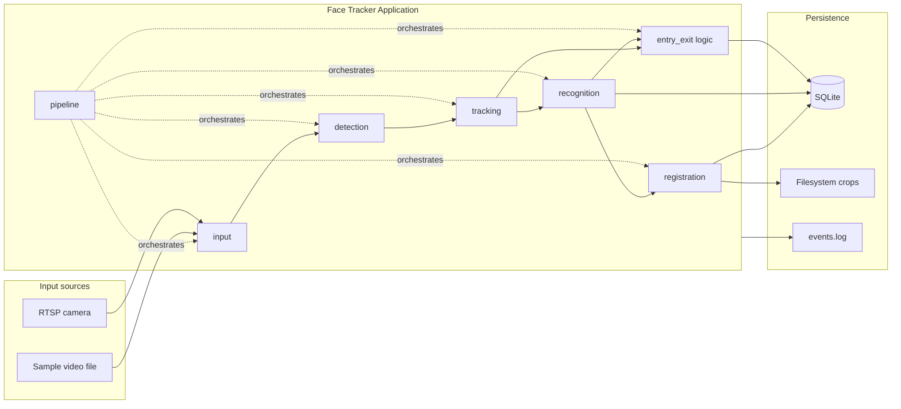
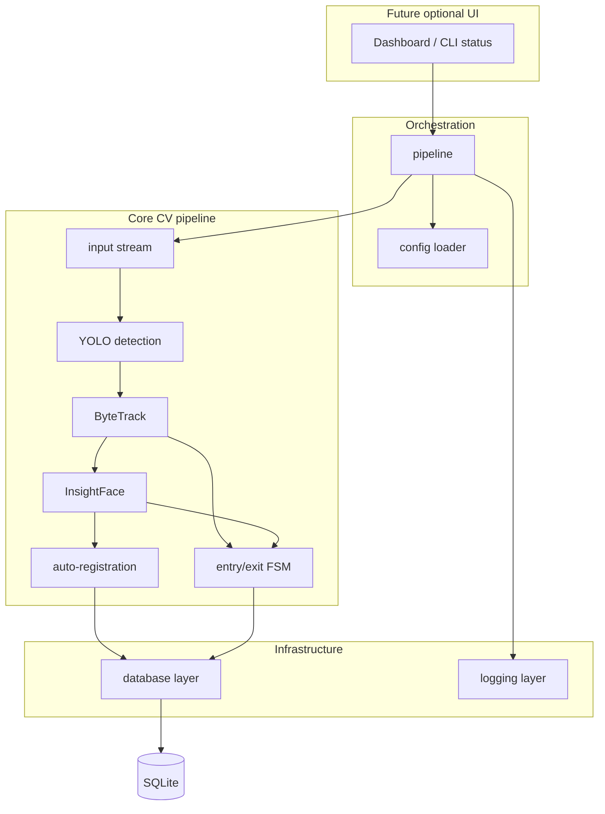
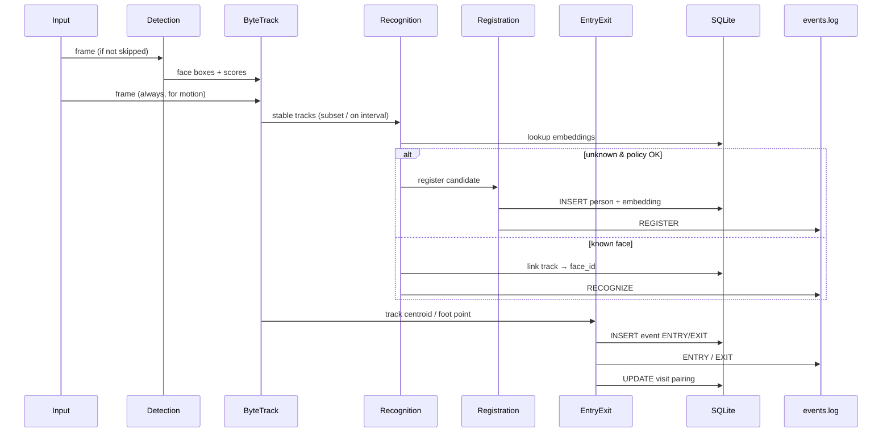
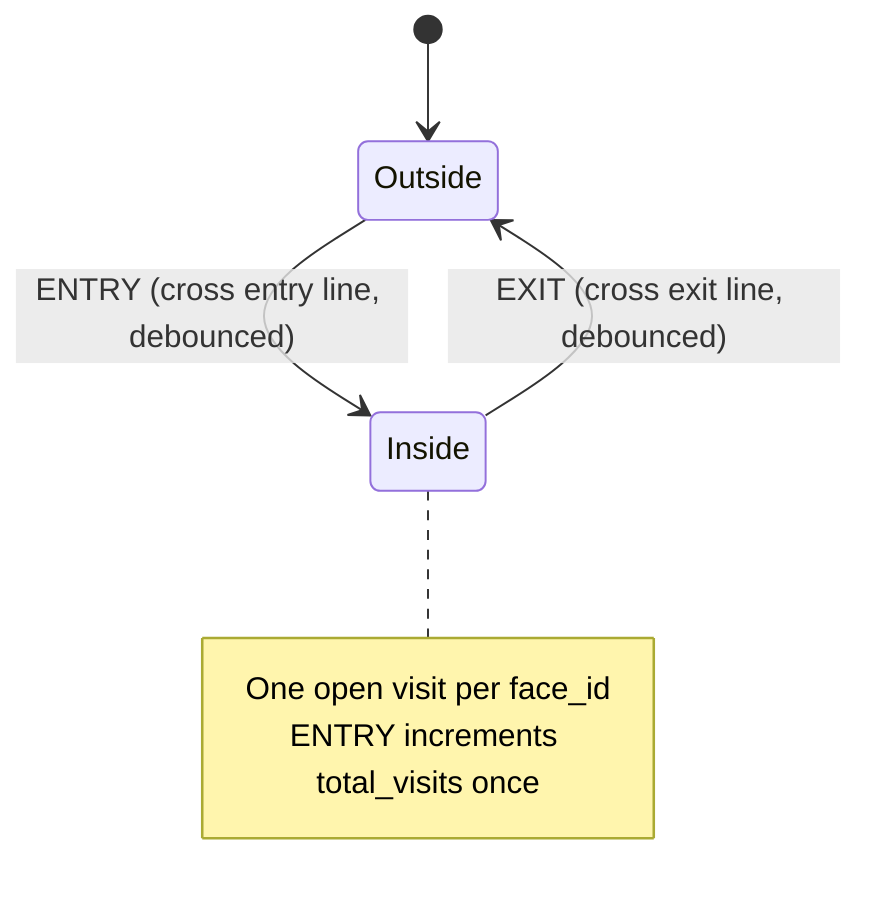
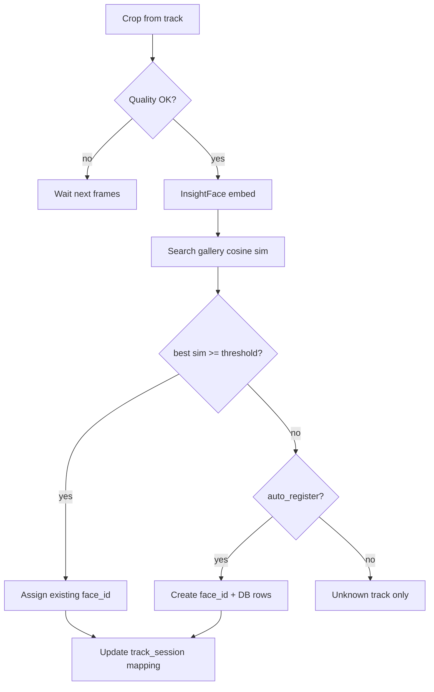
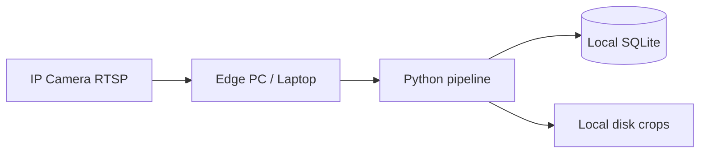

# System Architecture

Intelligent Face Tracker — architecture reference aligned with [docs/katomaran-problem-statement.pdf](docs/katomaran-problem-statement.pdf). Phase 2 implements `src/config/` and `src/database/`; CV pipeline modules remain pending.

---

## System context



---

## Layered module architecture



| Module | Responsibility | Config keys (examples) |
|--------|----------------|-------------------------|
| `input` | OpenCV capture; video loop or RTSP with reconnect | `input.*` |
| `detection` | YOLO inference on selected frames | `detection.*`, `detection_skip_frames` |
| `tracking` | ByteTrack: box → track_id | `tracking.*` |
| `recognition` | Align, embed, cosine match to gallery | `recognition.*` |
| `registration` | Create `face_id`, save crop, insert DB | `registration.*` |
| `database` | CRUD, transactions, visit pairing | `database.*` |
| `logging` | stdlib logging + business event file | `logging.*` |
| `pipeline` | Frame loop, skip-frame policy, backpressure | `performance.*` |

---

## Data flow (per frame)



**Skip-frame policy:** When `frame_index % (detection_skip_frames + 1) != 0`, reuse last detections or propagate tracks with prediction-only updates (ByteTrack), reducing YOLO cost.

---

## SQLite schema

Design goals: unique Face ID, no duplicate persons, append-only events, explicit visit pairing, embedding storage without redundant crops in DB.

```sql
-- Persons: one row per unique visitor identity (Face ID)
CREATE TABLE IF NOT EXISTS persons (
    face_id           TEXT PRIMARY KEY,          -- UUID or FT-xxxxxxxx
    display_label     TEXT,                      -- optional human label
    first_seen_at     TEXT NOT NULL,             -- ISO-8601 UTC
    last_seen_at      TEXT NOT NULL,
    total_visits      INTEGER NOT NULL DEFAULT 0,
    is_active         INTEGER NOT NULL DEFAULT 1,
    created_at        TEXT NOT NULL,
    updated_at        TEXT NOT NULL
);

-- Embeddings: multiple samples per person allowed; dedupe by hash
CREATE TABLE IF NOT EXISTS face_embeddings (
    embedding_id      INTEGER PRIMARY KEY AUTOINCREMENT,
    face_id           TEXT NOT NULL REFERENCES persons(face_id) ON DELETE CASCADE,
    model_name        TEXT NOT NULL,             -- e.g. buffalo_l
    model_version     TEXT,
    dimension         INTEGER NOT NULL,
    embedding         BLOB NOT NULL,             -- float32 little-endian
    embedding_hash    TEXT NOT NULL UNIQUE,      -- sha256 of normalized vector
    quality_score     REAL,
    source_image_path TEXT,                      -- path under data/faces or crops
    created_at        TEXT NOT NULL
);

CREATE INDEX IF NOT EXISTS idx_face_embeddings_face_id ON face_embeddings(face_id);

-- Tracks snapshot (optional, for debugging re-id switches)
CREATE TABLE IF NOT EXISTS track_sessions (
    track_session_id  INTEGER PRIMARY KEY AUTOINCREMENT,
    track_id          INTEGER NOT NULL,
    face_id           TEXT REFERENCES persons(face_id),
    started_at        TEXT NOT NULL,
    ended_at          TEXT,
    source_type       TEXT NOT NULL              -- video | rtsp
);

-- Append-only business events
CREATE TABLE IF NOT EXISTS events (
    event_id          INTEGER PRIMARY KEY AUTOINCREMENT,
    event_type        TEXT NOT NULL CHECK (event_type IN (
                          'REGISTER', 'RECOGNIZE', 'ENTRY', 'EXIT',
                          'TRACK_LOST', 'ERROR', 'SYSTEM'
                      )),
    face_id           TEXT REFERENCES persons(face_id),
    track_id          INTEGER,
    visit_id          INTEGER,                   -- logical FK; set after visit row exists
    confidence        REAL,
    image_path        TEXT,
    metadata_json     TEXT,                      -- line name, bbox, etc.
    created_at        TEXT NOT NULL
);

CREATE INDEX IF NOT EXISTS idx_events_face_id ON events(face_id);
CREATE INDEX IF NOT EXISTS idx_events_type_time ON events(event_type, created_at);

-- Visits: exactly one ENTRY and one EXIT per visit when complete
CREATE TABLE IF NOT EXISTS visits (
    visit_id          INTEGER PRIMARY KEY AUTOINCREMENT,
    face_id           TEXT NOT NULL REFERENCES persons(face_id),
    entry_event_id    INTEGER,                   -- FK to events.event_id (app-enforced)
    exit_event_id     INTEGER,
    entry_at          TEXT,
    exit_at           TEXT,
    status            TEXT NOT NULL DEFAULT 'open' CHECK (status IN ('open', 'closed')),
    created_at        TEXT NOT NULL,
    updated_at        TEXT NOT NULL,
    UNIQUE (face_id, entry_event_id)
);

CREATE INDEX IF NOT EXISTS idx_visits_face_open ON visits(face_id, status);

-- Runtime counters (optional materialized; can also derive from visits)
CREATE TABLE IF NOT EXISTS daily_stats (
    stat_date         TEXT NOT NULL,
    unique_visitors   INTEGER NOT NULL DEFAULT 0,
    total_entries     INTEGER NOT NULL DEFAULT 0,
    total_exits       INTEGER NOT NULL DEFAULT 0,
    PRIMARY KEY (stat_date)
);
```

### Duplication avoidance

- **Persons:** Primary key `face_id`; registration checks embedding gallery before insert.
- **Embeddings:** `embedding_hash` UNIQUE prevents storing identical vectors twice.
- **Visits:** At most one `open` visit per `face_id`; new ENTRY closes logic only after prior visit EXIT or timeout policy (see AI_PLANNING).

---

## Entry / exit strategy

The brief requires exactly one entry and one exit when a face enters and leaves the **camera frame**, with cropped image, timestamp, event type, and Face ID stored locally and in SQLite.

This design uses configurable geometry: default **line crossing** (`entry_exit.mode`: `line_crossing`) for entrance scenes; **frame boundary** mode is planned so frame enter/exit matches the brief without relying on virtual lines.



- **Geometry:** Normalized line segments in `config.json` (`entry_line`, `exit_line`).
- **Signal:** Track reference point (bbox bottom-center) crosses segment with direction check.
- **Debouncing:** `debounce_sec` and `min_track_age_frames` prevent flutter counts.
- **Pairing:** On ENTRY → create `visits` row (`status=open`); on EXIT → set `exit_event_id`, `status=closed`.

---

## Re-identification strategy



- Gallery built from `face_embeddings` (optionally centroids per person).
- **No visitor count bump** on RECOGNIZE alone — only on new visit ENTRY per rules in AI_PLANNING.

---

## Tracking strategy (ByteTrack)

- Input: face detections `[x1,y1,x2,y2,score]` each detection frame.
- Maintains `track_id` across occlusions using Kalman motion and two-stage association (high/low score boxes).
- **Track → face_id** mapping is many-to-one over time; remapping on ID switch uses embedding confirmation.

---

## Filesystem layout (crops)

| Path | Content |
|------|---------|
| `data/faces/{face_id}/` | Canonical registered images |
| `data/crops/` | Debug / pre-register crops (optional TTL) |
| `data/events/{YYYY-MM-DD}/` | ENTRY/EXIT snapshot JPEGs (config: `paths.events_snapshot_dir`; brief example: `logs/entries/YYYY-MM-DD/`) |

Paths stored in DB columns; binary blobs only for embeddings.

---

## Deployment view



Single-process monolith first; queue-based stages optional via `performance.max_pipeline_queue_size` in later optimization.

---

## Related documents

- [README.md](README.md) — overview and config table  
- [AI_PLANNING.md](AI_PLANNING.md) — edge cases, phases, CPU/GPU  
